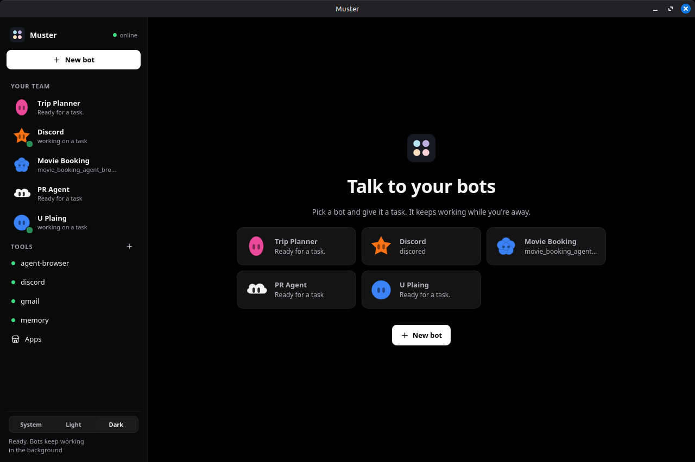
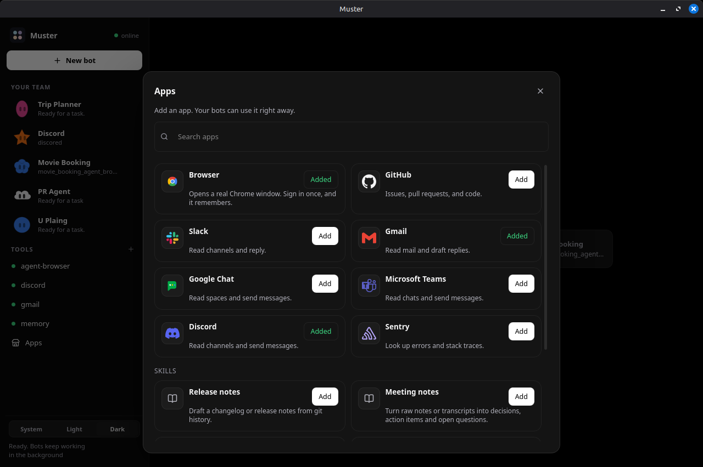

# Muster

**Personal bot coworkers on a local OpenCode harness.**

Muster is a local-first desktop app where every bot is a real agent with its
own name, face, persona, skills and tool access. Give one a task, switch chats,
and it keeps working in the background. Bots, chats and files stay on your
machine — no hosted workspace, no account.



## Highlights

- **Bots, not prompts.** Named bots with their own face, colleague persona, DM
  chat and history. Every bot is a plain Markdown file you can edit by hand.
- **Local-first.** A headless `opencode serve` harness runs on loopback and
  keeps all state in one portable folder.
- **No key required.** Each message is routed to a suitable free model; local
  Ollama / LM Studio and cloud keys also work.
- **Per-bot skills and tools.** Pick skills, then Allow / Deny each connector
  for that bot.
- **Apps marketplace.** Add GitHub, Slack, Gmail, Google Chat, Teams, Discord,
  Sentry, plugins and skills in a click, with OAuth sign-in where needed.
- **A real team view.** Roster dots show working, waiting-for-approval and
  replied-while-away states, even for chats you are not looking at.
- **Desktop and browser.** The Tauri app and `./run.sh` share one data folder.
- **System, light or dark.**

## Quick start

```sh
bun install            # once
cp .env.example .env   # optional: provider + websearch keys
```

### Desktop app

```sh
cp "$(which opencode)" src-tauri/binaries/opencode-$(rustc -vV | sed -n 's/^host: //p')
bun run tauri:dev
```

`bun run tauri:build` builds an installer (`.deb` on Linux; macOS and Windows
configs are included, and the GitHub Actions workflow builds all three).

### Browser

```sh
./run.sh   # harness + UI + browser; Ctrl+C stops everything
```

You need Bun >= 1.2 and OpenCode >= 2.0 on `PATH`. Rust is only needed for the
desktop app. Full setup, ports and sandboxing:
[docs/development.md](docs/development.md).

## How it works

```
React UI (Tauri webview or browser tab)
   │  HTTP + SSE · loopback · Basic auth
   ▼
opencode serve — agents, sessions, tools, MCP
   ▲
   │  spawned with XDG_* redirected into the data folder
Tauri shell (Rust) or Bun launcher (server/src/launcher.ts)
```

The shell picks a free loopback port, spawns the harness, captures its per-boot
password and hands the UI its coordinates — nothing is baked into the build.
The UI only talks to the harness API and never touches storage directly.
More: [docs/architecture.md](docs/architecture.md).

## Bots

**New bot** asks for a name and a face, then writes
`<workspace>/.opencode/agents/<slug>.md`: frontmatter plus a persona prompt.
Rename from the chat header (history follows), toggle skills, set per-connector
permissions, disable or delete. Hand-written files and unknown frontmatter keys
round-trip untouched. Details: [docs/bots.md](docs/bots.md).

## Apps

**Apps** installs MCP connectors, plugins and skills by editing the workspace
config — no terminal steps. GitHub and Discord take a token once; Slack, Sentry,
Gmail and Google Chat sign in with OAuth. Gmail and Google Chat need a one-time
Google Cloud OAuth client
([walkthrough](docs/bots.md#google-oauth-client-gmail-google-chat)).



## Data

| Mode | Data root |
| --- | --- |
| Desktop app | `~/.local/share/com.muster.app/muster/data` |
| Browser (`./run.sh`) | same root |
| Sandbox | `MUSTER_DATA_DIR=./data ./run.sh` |

Bots and skills are plain files under `workspace/`; all chats live in
`share/opencode/opencode.db` — back up that one file and you have every chat.
The harness password is minted per boot under `state/`. Run browser and desktop
one at a time against the same root.

## Docs

| Doc | What's inside |
| --- | --- |
| [architecture.md](docs/architecture.md) | Processes, data flow, harness protocol, storage, auth |
| [development.md](docs/development.md) | Setup, dev loop, sandboxing, verification, builds |
| [design.md](docs/design.md) | Design language, tokens, themes, chat anatomy |
| [bots.md](docs/bots.md) | Bot files, personas, skills, MCP rules, marketplace |

## Scripts

| Command | What it does |
| --- | --- |
| `./run.sh` | harness + UI + browser |
| `bun run start` | headless harness only |
| `bun run dev:web` | Vite UI only (needs `run.sh`'s exported vars) |
| `bun run build:web` | typecheck + production build |
| `bun run tauri:dev` | desktop window in dev mode |
| `bun run tauri:build` | desktop installer |

## Notes

- The ~200 MB `opencode` sidecar is gitignored; stage it as shown above.
- Rust is pinned to 1.98 in `src-tauri/rust-toolchain.toml`. rustc 1.98.x
  occasionally SIGSEGVs inside LLVM on some machines — rerun the build; it is
  flaky, not a code problem.
