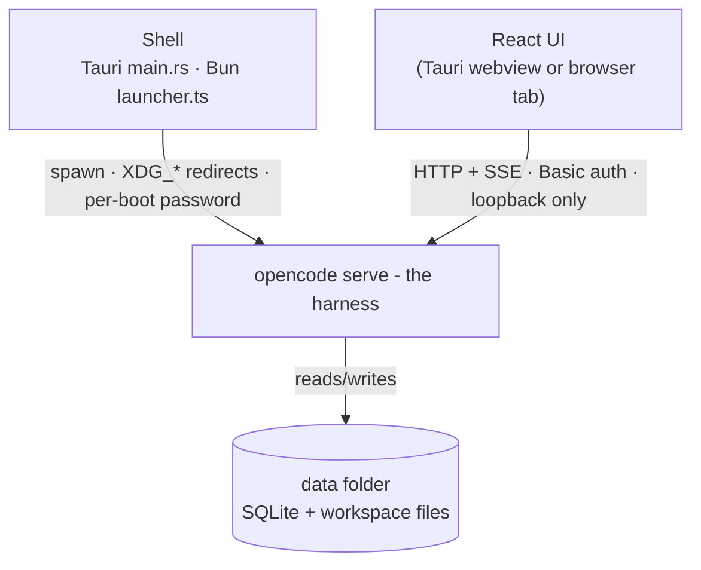

# Architecture

Muster is a thin, deliberate UI over a local agent runtime. Three processes,
one data folder, one long-lived event stream.



## Processes

### The harness (`opencode serve`)

A headless agent runtime. It owns everything stateful: agent definitions,
sessions, messages, permissions, skills, MCP connections, plugins, websearch.
It speaks a typed JSON API and a server-sent event stream. Nothing else in the
system touches its storage directly.

### The shell

Two interchangeable shells prepare the harness and hand the UI its coordinates
(URL, password, workspace):

- **Browser mode**: `run.sh` → `server/src/launcher.ts` (`bun run start`).
  The launcher resolves the data folder, redirects `XDG_*` + `OPENCODE_DB`
  into it, spawns `opencode serve` as a child, captures the per-boot password,
  writes `state/harness-token-<port>`, seeds `templates/workspace/`
  (copy-if-missing), and waits for `/api/info` to answer before printing the
  dev hint. It fails fast when the port is already taken.
- **Desktop mode**: `src-tauri/src/main.rs`. Picks a free loopback port,
  creates `<appData>/muster/data`, seeds templates, and spawns the bundled
  `opencode` sidecar with the same env redirects. The UI fetches URL +
  password over the Tauri commands `harness_info` / `harness_token` at boot -
  no tokens in the build, no env vars. The sidecar is killed on window close
  and app exit; CORS is granted to `tauri://localhost`, `http(s)://tauri.localhost`
  and the Vite dev origins.

### The UI

React + Vite (`src/`). All state comes from the harness over HTTP; all writes
go back through it. The UI holds no database, no secrets beyond the per-boot
token, and no engine logic.

## Data flow

1. **Boot.** `resolveTauriHarness()` (desktop) or the `VITE_OPENCODE_*` env
   (browser) configures the shared client in `src/lib/opencode.ts`
   (`OpenCode.make` with `Authorization: Basic base64("opencode:<pw>")`).
2. **Discovery.** Catalogs load over REST: models, agents (bots), skills, MCP
   servers, plugins, sessions, plus `permission.list` per session. Discovery
   after a write is async (~1 s), so the UI retries and polls instead of
   assuming.
3. **Event stream.** The UI streams `/api/event` with `fetch` + reader
   (EventSource can't attach the auth header) and reconnects automatically if
   the stream drops. `App.tsx` handles it as a `switch` over the generated
   `V2Event` union: message parts, tool state, `session.execution.*`,
   `session.idle`, `permission.asked/replied`, catalog changes.
4. **Chatting.** A bot's chat is a session created with
   `location: {directory: <workspace>}` and `metadata: {kind: "dm", bot: "<id>"}`.
   Prompts go through `session.prompt`; mid-turn prompts are queued by the
   harness inbox (`delivery: "queue"`) and the UI surfaces that honestly.
5. **Approvals.** `permission.list` at boot seeds pending approvals;
   `permission.asked/replied` events keep them live. Resolving sends
   `permission.reply` (Allow / Always / Deny).
6. **Config writes.** Bots, connectors, plugins and skills are written as
   files/config through the harness (`file.read/write/list`, workspace
   `opencode.jsonc`), then applied with `location.reload()`. The JSONC editor
   in `src/lib/jsonc.ts` rewrites only the touched spans, so comments and
   formatting elsewhere survive byte-for-byte.

## Session model

- One DM session per bot, titled with the bot's name; `metadata.bot` is the
  join key everywhere (roster, rename, unread dots).
- Renaming a bot updates the session title + metadata so history follows
  (`session.update`).
- Chats created by older builds that had skills force-injected at open are
  archived once (`metadata.kind = "dm-archived"`, transcript kept) and
  replaced with a fresh chat.
- Sessions that were mid-turn when the UI went away are re-marked "working"
  at boot (`time.updated > time.idle`) and re-verified by the stream.

## UI ↔ harness map

| UI element | Harness call |
| --- | --- |
| Bots sidebar | `GET /api/agent` (custom agents; built-ins and hidden ones filtered) |
| Disabled section | `file.list` on `.opencode/agents` minus the visible agents |
| Bot chat | `POST /api/session` (agent + `metadata: {kind: dm, bot}`), then prompts |
| Streaming + status | `GET /api/event` SSE (fetch + reader, auto-reconnect) |
| Model picker | `GET /api/model` + `session.get` (per-chat) + `session.switchModel` |
| Stop | `session.interrupt` |
| Permission prompt | `permission.list` + Allow / Always / Deny (`permission.reply`) |
| Bot files | `file.read` / `file.write` / `file.list` under `<workspace>/.opencode/agents/` |
| Skills / MCP catalogs | `skill.list`, `mcp.list` |
| Marketplace install/remove | `file.write` on the workspace `opencode.jsonc` + `location.reload`; live status from `mcp.list` / `plugin.list` / `skill.list` |

Keep the UI dumb: all agent/tool reasoning stays in the harness.

## Configuration sources

- **Base config**: `opencode.jsonc` in the harness cwd (repo root in dev;
  the bundled resource in release builds): default model, providers,
  websearch, base permissions.
- **Workspace config**: `<workspace>/opencode.jsonc`, written by the app
  when you install connectors or plugins; hand-written comments survive.
- **Environment**: provider and websearch keys via `.env` (Bun auto-loads it
  for the launcher), forwarded to the harness.

## Storage layout

Everything stateful lives under one root:

```
data/
├── workspace/   session location; .opencode/agents/*.md, .opencode/skills/<id>/SKILL.md,
│                opencode.jsonc (connectors, plugins - written by the app)
├── share/       XDG_DATA_HOME → opencode/opencode.db (sessions, messages), logs
├── config/      XDG_CONFIG_HOME
└── state/       XDG_STATE_HOME → harness-token-<port> (0600, minted per boot)
```

| Mode | Root |
| --- | --- |
| Browser (`./run.sh`) | `~/.local/share/com.muster.app/muster/data` |
| Desktop app | `~/.local/share/com.muster.app/muster/data` (same) |
| Sandbox | `MUSTER_DATA_DIR=./data ./run.sh` |

Back up `share/opencode/opencode.db` and you have backed up every chat.
`workspace/` is plain files (bots, skills, config).

Run browser and desktop **one at a time** against the same root: two harnesses
sharing one SQLite database would fight over session state.

## Auth & security

- `opencode serve` binds **loopback only** and guards every route with HTTP
  Basic, user `opencode`, password printed once per boot
  (`server password <pw>`); the shell captures it to
  `state/harness-token-<port>` (mode 0600) and hands it to the UI.
- The desktop webview runs under a strict CSP (loopback-only connect-src) and
  Tauri capabilities grant only `core:default`; the sidecar is spawned from
  Rust, so no shell permissions are exposed to the page.
- The UI keeps the token in memory only; nothing is baked into any build.

## Reliability behaviors

- SSE reconnects on drop; catalogs poll after writes because discovery is
  async.
- Busy state is per session with a 100 s activity watchdog, so one stuck turn
  doesn't freeze the roster.
- Approvals are seeded at boot and kept live from events.
- Prompt queueing is a harness feature surfaced by the UI, not a UI retry.
- Reasoning parts (`session.reasoning.*`) are intentionally hidden - the UI
  renders final text + tool activity only.

## Repository map

| Path | Role |
| --- | --- |
| `run.sh` | browser-mode one-command launcher |
| `server/src/launcher.ts` | Bun shell: env isolation, spawn, token capture, seeding |
| `opencode.jsonc` | base harness config (model, providers, websearch, permissions) |
| `templates/workspace/` | starter files seeded on first boot (e.g. the `manage-skills` skill) |
| `src/` | React UI; `lib/` holds the client, bot and marketplace layers |
| `src/marketplace.json` + `src/marketplace-skills/` | bundled catalog + skill bodies |
| `src-tauri/` | Rust desktop shell (port pick, sidecar, commands) |
| `docs/` | these documents |
